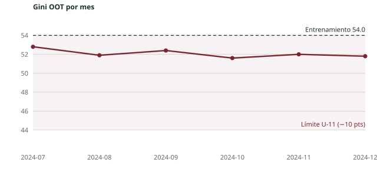

# Control del documento

| Campo | Valor |
|---|---|
| Código de modelo | MOD-EJEMPLO-001 |
| Nombre | Score de originación TC — ejemplo |
| Estándar aplicado | Desarrollo · Tier II · Machine learning · enfoque agil |
| Versión y estado | 1.0 · Para Comité de Modelos |
| Clasificación | Uso interno |
| Versión del estándar | Estándares de Modelos en Banca v2.2.0 |

**Control de cambios** (DES-D4-11.01.03)

| Versión | Fecha | Autor | Cambio |
|---|---|---|---|
| 1.0 | 2026-10-20 | Analista de modelos (ejemplo) | Versión para Comité de Modelos |

# Resumen ejecutivo

El modelo es un gradient boosting con restricciones monotónicas sobre 24 variables de buró, de relación con el banco y de la solicitud. Alcanza un Gini OOT de 52.1 (54.0 en entrenamiento; diferencia de 1.9 pts) y supera en 6.4 pts al modelo vigente en las cosechas aprobadas de los últimos seis meses. Su uso propuesto reduce en 0.8 pp la mora a 12 meses de la cosecha manteniendo el volumen de aprobación.

# Propósito, uso y alcance

**Propósito.** Ordenar por riesgo las solicitudes de tarjeta de crédito para sustentar la decisión de aprobación y el tramo de línea inicial.

**Uso aprobado.** Admisión de solicitudes de tarjeta de crédito de personas naturales

**Usos no permitidos.**

- Pricing individual sin un modelo de respuesta aprobado (estándar PRC).
- Clientes con más de 6 meses de antigüedad (corresponde el modelo de comportamiento).

| Atributo | Valor |
|---|---|
| Dueño del modelo | Gerencia de producto de tarjetas (ejemplo) |
| Modelo que reemplaza | MOD-EJEMPLO-000 (versión 2021) |
| Categoría (Tier) | II — determina la profundidad de validación y seguimiento (U-35) |

# Datos

## Fuentes y no anticipación

| Fuente | Contenido | Desfase de disponibilidad |
|---|---|---|
| Buró de crédito | Endeudamiento y comportamiento en el sistema | 1 mes |
| Relación con el banco | Productos, saldos y comportamiento de pago interno | 0 meses |
| Solicitud | Datos declarados y del canal al momento de la solicitud | 0 meses |

Las 412 variables candidatas tienen fecha de referencia y desfase documentados; la prueba automática confirmó que ninguna usa información posterior a la fecha de solicitud.

## Universo, ventana y definición de default

**Universo.** Solicitudes aprobadas de tarjeta de crédito de personas naturales, enero 2023 a diciembre 2024.

| Muestra | Período | Meses |
|---|---|---:|
| Entrenamiento y prueba | enero 2023 a junio 2024 | 18 |
| Fuera de tiempo (OOT) | julio a diciembre 2024 | 6 |

**Default.** Atraso mayor a 60 días al menos una vez en los 12 meses siguientes a la originación (U-17).

## Exclusiones

| Criterio | Registros | % del universo |
|---|---:|---:|
| Pautas duras de política | 41 250 | 6.2 % |
| Desempeño incompleto (menos de 12 meses) | 18 400 | 2.8 % |
| Indeterminados (atraso máximo entre 31 y 60 días) | 9 870 | 1.5 % |
| Fraude confirmado | 640 | 0.1 % |

## Calidad de datos

Certificación de calidad aprobada (Documento 6). Sin duplicados; fill rate mínimo de las variables finales de 91 %.

# Segmentación

**Decisión.** Modelo unisegmento.

Los modelos por segmento (ingreso dependiente e independiente) no superaron al unisegmento en más de 0.6 pts de Gini OOT y reducían la materialidad de defaults por segmento.

# Variables

## Embudo de variables

Orden aplicado antes del entrenamiento: no anticipación, univariado, fill rate y estabilidad, bivariado (WOE/IV),
sospecha de fuga, filtro de confiables y correlación (DES-D4-03.03.04).

| Etapa | Variables que quedan | Motivo de las salidas |
|--------------------------------|---------:|--------------------------------|
| Variables candidatas | 412 |  |
| No anticipación (U-39) | 405 | 7 variables contemporáneas (saldos al cierre del mes de solicitud) |
| Fill rate mínimo del plan (70 %) | 351 | 54 variables con bajo poblamiento |
| Estabilidad PSI ≤ 10 % (U-02) | 318 | 33 variables inestables |
| IV entre 0.02 y 0.50 (U-38) | 196 | 120 sin poder predictivo y 2 con sospecha de fuga |
| Correlación < 60 % (U-06) | 88 |  |
| Selección por gain y sentido económico | 24 |  |

## Variables finales

| Variable | Descripción | IV | PSI | Signo |
|---------------------------|------------------------------------------|------:|------:|:----:|
| `max_atraso_buro_6m` | Atraso máximo en el sistema en los 6 meses previos | 0.41 | 0.03 | + |
| `utilizacion_lineas_buro` | Uso promedio de líneas revolventes en el sistema | 0.29 | 0.05 | + |
| `antiguedad_buro_meses` | Meses desde el primer producto en el sistema | 0.22 | 0.02 | − |
| `num_consultas_3m` | Consultas al buró en los 3 meses previos | 0.17 | 0.06 | + |
| `ratio_cuota_ingreso` | Cuota estimada sobre ingreso declarado | 0.12 | 0.04 | + |

# Metodología

| Elemento | Detalle |
|---|---|
| Algoritmo | Gradient boosting (XGBoost) con restricciones monotónicas en las 24 variables. |
| Benchmark interpretable | Regresión logística con WOE (Gini OOT 49.3) |
| Validación cruzada | 5 particiones temporales. |
| Combinaciones de hiperparámetros | 60 |
| Semilla | 20261017 |

**Hiperparámetros finales:** `max_depth` = 4 · `eta` = 0.05 · `n_estimators` = 600 · `subsample` = 0.8 · `colsample_bytree` = 0.7.

# Desempeño

## Discriminación por muestra

| Muestra | Registros | Tasa de default | Gini | KS |
|---|---:|---:|---:|---:|
| Entrenamiento | 412 300 | 7.1 % | 54.0 | 40.8 |
| Prueba | 103 080 | 7.0 % | 52.9 | 39.9 |
| OOT | 96 450 | 7.6 % | 52.1 | 39.2 |
Diferencia de Gini entre entrenamiento y OOT: **1.9 pts** — cumple U-11 (máximo 10 pts). El modelo vigente tiene un Gini OOT de 45.7: mejora de **6.4 pts**.

## Estabilidad mensual

{ width=85% }

## Calibración

| Tramo | Registros | PD estimada | Tasa observada | Desvío relativo |
|---|---:|---:|---:|---:|
| 1 | 9 640 | 1.2 % | 1.1 % | −8.3 % |
| 2 | 9 650 | 2.4 % | 2.6 % | +8.3 % |
| 3 | 9 645 | 4.1 % | 3.9 % | −4.9 % |
| 4 | 9 640 | 6.8 % | 7.1 % | +4.4 % |
| 5 | 9 650 | 11.2 % | 10.8 % | −3.6 % |
| 6 | 9 645 | 19.8 % | 20.4 % | +3.0 % |

# Interpretabilidad, sensibilidad y equidad

**Interpretabilidad.** Las contribuciones SHAP confirman el sentido económico de las 24 variables; la estabilidad de las explicaciones se verificó en 50 remuestreos y no hubo variables con contribución inestable.

**Sensibilidad.** Un deterioro de 10 % en las variables de buró aumenta la PD promedio de 7.1 % a 7.9 %; el ordenamiento se mantiene.

**Equidad.** No se usan atributos protegidos. La edad se probó como proxy: el AUC para predecirla con las variables del modelo es 0.58. Las tasas de verdaderos positivos por rango de edad difieren en menos de 3 pp.

# Integración a la gestión

**Punto de corte.** Aprobación hasta el tramo 5; el tramo 6 pasa a revisión manual.

| Indicador | Actual | Propuesto |
|---|---:|---:|
| Tasa de aprobación | 62.0 % | 62.0 % |
| Mora 60+ a 12 meses de la cosecha | 7.1 % | 6.3 % |

**Forzajes.** Solo jefaturas de agencia, con motivo de una lista cerrada, hasta 3 % de las decisiones (U-36).

# Limitaciones

- El modelo no se validó para clientes sin historial en el buró (5 % de las solicitudes); se usa una política experta.
- El desempeño en el canal digital es 3 pts de Gini menor y se monitoreará por separado.

# Seguimiento

Seguimiento mensual de PSI y forzajes; discriminación y calibración trimestral con cosechas maduras (SEG-S1).

# Cumplimiento del estándar

## Umbrales

| Umbral | Tema | Valor obtenido | Regla | Resultado |
|------|--------------------------|-------:|------------------------------------|-------------|
| U-01 | Ventana de modelamiento | 18 + 6 | ≥ 12 meses entrenamiento/prueba y ≥ 6 OOT | **Cumple** |
| U-02 | Estabilidad poblacional / de variables (PSI) | 0.06 | PSI máximo de las variables del modelo ≤ 0.10 (≤ 0.20 con excepción) | **Cumple** |
| U-03 | Representatividad de la muestra | 1.01 | Ratio TM/TG entre 0.95 y 1.05 | **Cumple** |
| U-06 | Correlación entre variables continuas | 0.57 | Correlación máxima entre continuas < 0.60 (≤ 0.95 con sustento) | **Cumple** |
| U-10 | Optimización de hiperparámetros | 60 | Combinaciones de hiperparámetros probadas ≥ 50 | **Cumple** |
| U-11 | Sobreajuste Train vs OOT | 1.9 | \|Gini Train − Gini OOT\| ≤ 10 pts | **Cumple** |
| U-38 | Rango de IV y sospecha de fuga | 0.41 | IV máximo de las variables del modelo ≤ 0.50 (salvo investigación de fuga documentada) | **Cumple** |
| U-39 | No anticipación temporal de las variables | 0 | Variables con información posterior a la observación = 0 | **Cumple** |

## Matriz de requisitos

Requisitos aplicables a un modelo Desarrollo Tier II, Machine learning, enfoque agil. Sin manifiesto de evidencias: todos figuran como pendientes (ver `tools/verificar.py --init`).

| Fase | Aplicables | Cumplidos | Excepción | No aplica | Pendientes |
|----------------------------------------|------:|------:|------:|------:|------:|
| DES-D1 · Definición, alcance, diseño y extracción | 56 | 0 | 0 | 0 | 56 |
| DES-D2 · Preparación, calidad y entendimiento de los datos | 18 | 0 | 0 | 0 | 18 |
| DES-D3 · Segmentación | 6 | 0 | 0 | 0 | 6 |
| DES-D4 · Modelamiento | 78 | 0 | 0 | 0 | 78 |
| DES-D5 · Integración a la gestión | 9 | 0 | 0 | 0 | 9 |
| DES-D7 · Gobierno | 7 | 0 | 0 | 0 | 7 |
| IMP · Implementación | 28 | 0 | 0 | 0 | 28 |
| **Total** | **202** | **0** | **0** | **0** | **202** |

# Gobierno y aprobaciones

| Acta | Hito | Fecha | Estado |
|---|---|---|---|
| ACTA-MOD-EJEMPLO-001-01 | Reunión 1 | 2026-06-02 | Aprobada |
| ACTA-MOD-EJEMPLO-001-05 | Reunión 5 · Selección del modelo final | 2026-09-18 | Aprobada |

El modelo no se usa sin la aprobación previa del comité de riesgos de modelo (GOB-G3-01.01.01).

# Referencias

- Siddiqi, N. (2017). *Intelligent Credit Scoring: Building and Implementing Better Credit Risk Scorecards* (2.ª ed.). Wiley.
- Board of Governors of the Federal Reserve System, OCC y FDIC (2026). *Revised Guidance on Model Risk Management* (SR 26-2; OCC Bulletin 2026-13; FDIC FIL-15-2026).
- Superintendencia de Banca, Seguros y AFP (2023). *Reglamento de Gestión de Riesgos de Modelo* (Resolución SBS n.º 00053-2023).
